  

## ◤ STATUS PANEL

  

## ◤ SEKILAS

  

  
Versi teks

  Saya **Khairul Faridz** (`kyunn17`), siswa Rekayasa Perangkat Lunak di **SMKN 4 Padalarang** yang sedang menjalani **PKL** di lingkungan software development. Fokus utama saya di **frontend**, dan sekarang sedang belajar **fullstack** serta mengeksplor **data engineering**. Saya lebih suka paham *kenapa* sesuatu bekerja daripada sekadar copy-paste, dan paling cepat belajar lewat proyek nyata.

## ◤ MISSION LOG

### ▰ MISSION 01 — CSV Template Validation
> **Brief:** Web app untuk mengatur aturan validasi CSV secara dinamis, memvalidasi file unggahan, lalu mengintegrasikan data yang valid ke **Databricks**.

  
  

[↗ Buka repo](https://github.com/kyunn17/CSV-Template-Validation)

---

### ▰ MISSION 02 — LifeSync
> **Brief:** Platform wellness untuk mengelola kesehatan dan kebiasaan harian.

  
  

[↗ Buka repo](https://github.com/kyunn17/LifeSync)

---

### ▰ MISSION 03 — SBL Gym Management System
> **Brief:** Konsep aplikasi gym yang mencakup membership, langganan, booking kelas, dan absensi.

[↗ Buka repo](https://github.com/kyunn17/SBL-Gym-Management-System)

---

### ▰ MISSION 04 — CRITIPLAY · `TEAM MISSION`
> **Brief:** Proyek tim bersama teman (React + Laravel).

> [!NOTE]
> **Peran saya:** hanya **frontend pada tahap awal**, dikerjakan bersama teman. Backend dan bagian lainnya dikerjakan tim.

  
  

[↗ Buka repo](https://github.com/kyunn17/CRITIPLAY)

---

### ▰ MISSION 05 — Personal Developer Portfolio · KF.
> **Brief:** Website pribadi dengan potret dan orbit logo teknologi 360° yang bisa diputar.

[↗ Buka portfolio](https://khairulfridz.my.id)

## ◤ SKILL MATRIX

  <b>▸ Sudah nyaman dipakai</b>  
  

  <b>▸ Sedang dilatih · Fullstack</b>  
    
  
  
  

  <b>▸ Sedang dieksplor · Data Engineering</b>  
  
  
  
  
  
  

  <b>▸ Tools</b>  
    
  

## ◤ CONNECTION

  

  
  
  

<i>Masih tumbuh, masih membangun.</i>

