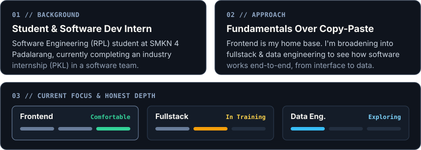

  

  

  
Plain-text summary

  Hi, I'm **Khairul Faridz** (`@kyunn17`), a Software Engineering (RPL) student at **SMKN 4 Padalarang** currently completing an industry internship (**PKL**) in software development. **Frontend** is my strongest area, and I'm actively expanding into **fullstack** and **data engineering** to understand how software works end-to-end — from user interface down to data pipelines. I prefer understanding *why* something works over copy-pasting, and I learn fastest by building real projects.

## Selected Projects

### CSV Template Validation
Dynamic rule-based CSV validation web app that lets users define custom schemas, validate uploaded CSV files, and route clean records into **Databricks**.

  
  
  &nbsp;·&nbsp;
  <a href="https://github.com/kyunn17/CSV-Template-Validation"><b>View Repository →</b></a>

---

### LifeSync
Digital wellness web platform designed to help users manage daily health routines and build consistent habits.

  
  
  
  &nbsp;·&nbsp;
  <a href="https://github.com/kyunn17/LifeSync"><b>View Repository →</b></a>

---

### Trainsmart Tracker
Gym management system concept covering member registration, recurring subscriptions, class scheduling/booking, and attendance tracking.

  <a href="https://github.com/kyunn17/Trainsmart-tracker"><b>View Repository →</b></a>

 

---

### CRITIPLAY &nbsp;`TEAM PROJECT`
Collaborative web application built together with friends.

> [!NOTE]
> **My Role:** Contributed strictly to **early-stage frontend development** alongside a teammate. Backend services and remaining application modules were built by the rest of the team.

  
  
  &nbsp;·&nbsp;
  <a href="https://github.com/kyunn17/CRITIPLAY"><b>View Repository →</b></a>

---

### Personal Developer Portfolio — `KF.`
Space-themed personal portfolio featuring an interactive, draggable 360° technology orbit.

  <a href="https://khairulfridz.my.id"><b>Visit Portfolio (khairulfridz.my.id) →</b></a>

## Technical Stack

  <b>Frontend · Comfortable</b>  
  

  <b>Fullstack · Currently Learning</b>  
    
  
  
  

  <b>Data Engineering · Exploring</b>  
  
  
  
  
  
  

  <b>Tools &amp; Workflow</b>  
    
  

## Connect

  
  
  

<i>Still learning, still building.</i>

