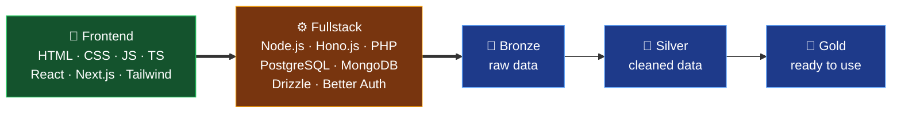

<!-- ═════════════ HEADER ═════════════ -->
<p align="center">
  
</p>

<p align="center">
  <a href="https://github.com/kyunn17">
    
  </a>
</p>

<p align="center">
  
  
  
</p>

---

## 🎮 `CHARACTER SHEET`

```yaml
name:        Khairul Faridz
class:       Frontend Developer
sub-class:   Fullstack Dev      [unlocking... 🔓]
             Data Engineer      [unlocking... 🔓]
guild:       SMKN 4 Padalarang — Rekayasa Perangkat Lunak
current_quest: PKL di lingkungan software development
playstyle:   belajar lewat proyek nyata, bukan sekadar copy-paste
motto:       "Paham dulu cara kerjanya, baru ngebut."
```

```text
FRONTEND          ██████████░░  Nyaman & jadi fokus utama
FULLSTACK         ██████░░░░░░  Lagi aktif dilatih
DATA ENGINEERING  ███░░░░░░░░░  Lagi eksplor, masih tahap awal
```

> 📌 Bar di atas cuma gambaran jujur soal posisi belajar saya sekarang, bukan klaim level. Saya masih tumbuh, dan itu memang tujuannya.

---

## 🗺️ `SKILL TREE`



<p align="center">
  🟢 <b>Dikuasai & dipakai</b> &nbsp;·&nbsp; 🟠 <b>Sedang dipelajari</b> &nbsp;·&nbsp; 🔵 <b>Sedang dijelajahi</b><br/>
  <sub>Data Engineering: Databricks · PySpark · SQL · Delta Tables · Medallion Architecture</sub>
</p>

---

## 🧭 `QUEST LOG`

<table>
  <tr>
    <td width="50%" valign="top">
      <h3>📊 CSV Template Validation</h3>
      <p>Atur aturan validasi CSV secara dinamis, validasi file yang diunggah, lalu kirim data valid ke <b>Databricks</b>. Tempat saya pertama kali menyentuh dunia data.</p>
      <p><code>Next.js</code> <code>API Routes</code> <code>Databricks</code></p>
      <a href="https://github.com/kyunn17/CSV-Template-Validation"></a>
    </td>
    <td width="50%" valign="top">
      <h3>🌿 LifeSync</h3>
      <p>Aplikasi web untuk mengelola kesehatan dan kebiasaan harian. Konsep aplikasi kesehatan digital.</p>
      <p><code>Next.js</code> <code>Express.js</code></p>
      <a href="https://github.com/kyunn17/LifeSync"></a>
    </td>
  </tr>
  <tr>
    <td width="50%" valign="top">
      <h3>🏋️ SBL Gym Management</h3>
      <p>Konsep sistem manajemen gym: membership, langganan, booking kelas, dan absensi.</p>
      <a href="https://github.com/kyunn17/SBL-Gym-Management-System"></a>
    </td>
    <td width="50%" valign="top">
      <h3>🎮 CRITIPLAY <sub>(team quest)</sub></h3>
      <p>Proyek kolaborasi bersama teman.</p>
      <p>📝 <b>Peran saya:</b> kontribusi di <b>frontend</b> tahap awal. Backend dan bagian lain dikerjakan tim.</p>
      <p><code>React</code> <code>Laravel</code></p>
      <a href="https://github.com/kyunn17/CRITIPLAY"></a>
    </td>
  </tr>
  <tr>
    <td colspan="2" align="center">
      <h3>🌌 Personal Developer Portfolio — <i>KF.</i></h3>
      <p>Portofolio interaktif bertema luar angkasa: potret dengan orbit logo teknologi 360° yang bisa diputar.</p>
      <a href="https://your-portfolio-link.com"></a>
    </td>
  </tr>
</table>

---

## 🧰 `INVENTORY`

<p align="center">
  <br/>
  <br/><br/>
  
  
  
  
</p>

---

## 📈 `PLAYER STATS`

<p align="center">
  
  
</p>

<p align="center">
  
</p>

---

## 💬 `SAVE POINT`

<p align="center">
  <a href="https://your-portfolio-link.com"></a>
  <a href="https://linkedin.com/in/USERNAME"></a>
  <a href="mailto:email@kamu.com"></a>
</p>

<p align="center"><i>🎯 Still growing. Still building. Quest berikutnya: yang lebih besar.</i></p>


