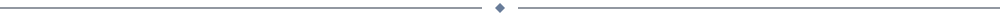
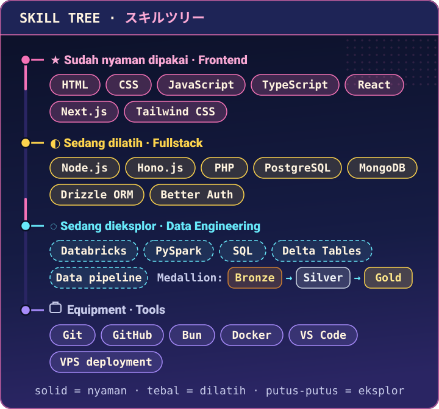

  

  
  
  

## 🎴 Character Profile キャラクター紹介

  
  

Saya **Khairul Faridz** (`kyunn17`), siswa Rekayasa Perangkat Lunak di **SMKN 4 Padalarang** yang sedang menjalani **PKL** di lingkungan software development. Fokus utama saya ada di **frontend**, sementara **fullstack** dan **data engineering** sedang saya pelajari dan eksplor karena penasaran bagaimana sebuah aplikasi bekerja dari tampilan layar sampai ke alur datanya.

Saya lebih suka paham *kenapa* sesuatu bekerja daripada sekadar copy-paste, dan paling cepat belajar lewat membangun proyek nyata.

## 📺 Episode List エピソード一覧

### `EP.01` · CSV Template Validation
> **Sinopsis:** Web app untuk mengatur aturan validasi CSV secara dinamis, memvalidasi file unggahan, lalu mengintegrasikan data yang valid ke **Databricks**.

  
  

[▶ Tonton di GitHub](https://github.com/kyunn17/CSV-Template-Validation)

---

### `EP.02` · LifeSync
> **Sinopsis:** Platform wellness untuk mengelola kesehatan dan kebiasaan harian dalam satu konsep aplikasi kesehatan digital.

  
  

[▶ Tonton di GitHub](https://github.com/kyunn17/LifeSync)

---

### `EP.03` · SBL Gym Management System
> **Sinopsis:** Konsep sistem manajemen gym yang mencakup membership, langganan, booking kelas, dan absensi.

[▶ Tonton di GitHub](https://github.com/kyunn17/SBL-Gym-Management-System)

---

### `EP.04` · `GUEST EPISODE` · CRITIPLAY
> **Sinopsis:** Proyek kolaborasi tim bersama teman dengan stack React dan Laravel.

> [!NOTE]
> **Peran saya:** kontribusi hanya di bagian **frontend pada tahap awal**, dikerjakan bersama teman. Backend dan bagian lainnya dikerjakan tim.

  
  

[▶ Tonton di GitHub](https://github.com/kyunn17/CRITIPLAY)

---

### `EP.05` · `SPECIAL` · Personal Developer Portfolio · KF.
> **Sinopsis:** Website pribadi bertema luar angkasa dengan potret dan orbit logo teknologi 360° yang bisa diputar.

[▶ Masuk ke universe-nya](https://khairulfridz.my.id)

## 🌳 Skill Tree スキルツリー

  

   
  
    
  
  
  
  

## 🎬 Ending Credits エンディング

  

  
  
  

<i>Masih tumbuh, masih membangun. — つづく</i>

