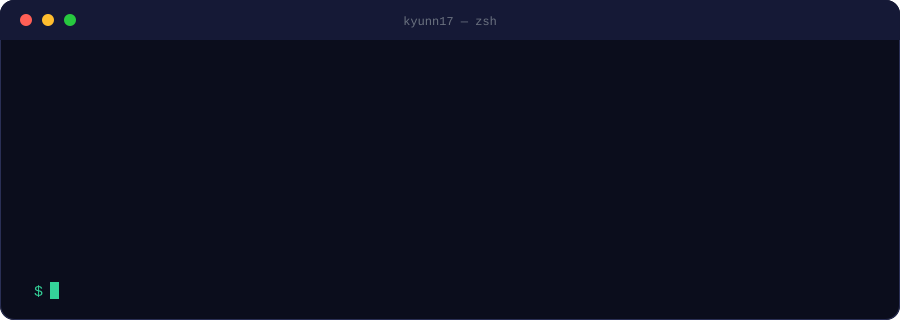

  

  
  
  

## ⚡ Sekilas

  

Saya siswa Rekayasa Perangkat Lunak di **SMKN 4 Padalarang** yang sedang menjalani **PKL** di lingkungan software development. Fokus utama saya saat ini adalah **frontend**, dan sedang melebar ke **fullstack** serta **data engineering** karena saya penasaran bagaimana sebuah aplikasi hidup dari layar sampai ke datanya.

Saya lebih suka memahami *kenapa* sesuatu bekerja daripada sekadar copy-paste, dan belajar paling cepat lewat membangun proyek nyata.

## 🧭 Proyek

<table>
  <tr>
    <td width="50%" valign="top">
      <h3>📊 CSV Template Validation</h3>
      
Web app untuk mengatur aturan validasi CSV secara dinamis, memvalidasi file yang diunggah, lalu mengintegrasikan data yang valid ke <b>Databricks</b>.

      

        
        
      

      <a href="https://github.com/kyunn17/CSV-Template-Validation">Lihat repo →</a>
    </td>
    <td width="50%" valign="top">
      <h3>🌿 LifeSync</h3>
      
Web untuk mengelola kesehatan dan kebiasaan harian. Konsep aplikasi kesehatan digital.

      

        
        
      

      <a href="https://github.com/kyunn17/LifeSync">Lihat repo →</a>
    </td>
  </tr>
  <tr>
    <td width="50%" valign="top">
      <h3>🏋️ SBL Gym Management</h3>
      
Konsep sistem manajemen gym yang mencakup membership, langganan, booking kelas, dan absensi.

      <a href="https://github.com/kyunn17/SBL-Gym-Management-System">Lihat repo →</a>
    </td>
    <td width="50%" valign="top">
      <h3>🎮 CRITIPLAY · proyek tim</h3>
      
Proyek kolaborasi bersama teman.

      
📝 <b>Peran saya:</b> kontribusi di <b>frontend</b> pada tahap awal. Backend dan bagian lainnya dikerjakan tim.

      

        
        
      

      <a href="https://github.com/kyunn17/CRITIPLAY">Lihat repo →</a>
    </td>
  </tr>
  <tr>
    <td colspan="2" align="center">
      <h3>🌌 Personal Developer Portfolio · KF.</h3>
      
Website pribadi bertema luar angkasa dengan potret dan orbit logo teknologi 360° yang bisa diputar.

      <a href="https://khairulfridz.my.id"><b>Masuk ke universe-nya →</b></a>
    </td>
  </tr>
</table>

## 🔭 Lagi Dipelajari

- **Fullstack:** Hono.js, Node.js, PostgreSQL, MongoDB, Drizzle ORM, Better Auth
- **Data Engineering:** Databricks, PySpark, SQL, Delta Tables, Medallion Architecture (Bronze → Silver → Gold), data pipeline dan integrasi data

## 🧰 Toolbox

   
    
  
  
  
  

## 💬 Ngobrol Yuk

  
  
  

<i>Masih tumbuh, masih membangun.</i>

